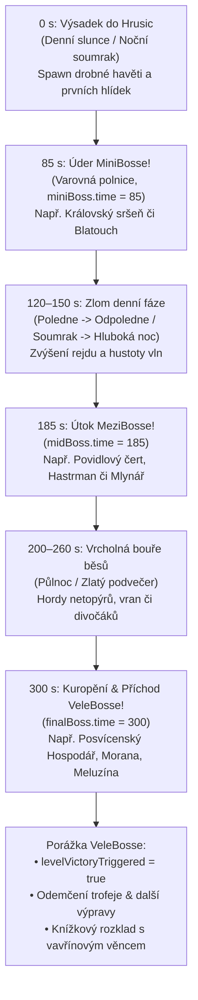

# Bubákov: Velký průvodce tvorbou výprav a malováním kraje
> **Dokument**: `docs/STAGE_CREATION_GUIDE.md`  
> **Verze**: 2.1 (Září 2026 – Aktualizováno pro 14 výprav / 7 kalendářních měsíců)  
> **Autoři**: Hrusický ponocný, rada starších a architekti Bubákova  
> **Kánon**: `GLOSSARY.md`, ADRs `0001`–`0040`, Stages 1–14 (Březen až Září)

---

```
             /\
            /  \        HRUSICKÁ KRONIKA TVŮRCŮ VÝPRAV
           / /\ \       ==============================
          / /  \ \      „Kdo maže, ten jede. Kdo v Hrusicích nemíchá povidla,
         / / /\ \ \      toho Meluzína sfoukne do rybníka. A kdo zapomene
        / / /  \ \ \     na ohraničení plátna, toho stihne hněv obecního písaře!“
       /_/ /____\ \_\
         |  ____  |
         | |    | |     Architektonický kodex pro tvorbu nových měsíců,
         | | [] | |     folklórních arén, nočních přízraků a ladovských kvašů.
         |_|____|_|
```

Tento dokument představuje **vyčerpávající technickou a folklórní bibli** pro tvorbu nových hratelných výprav (**Výpravy**), sezónních krajů (**Kraje**) a bitevních polí (**Arény**) v **Bubákově**. Shrnuje zkušenosti nabyté při stavbě všech 14 úrovní (od březnového tání až po svatováclavskou podzimní noc) a slouží jako neprůstřelný návod pro budoucí měsíce (Říjen, Listopad, Prosinec a zimní cyklus).

---

## 1. Ladovské desatero pro stavitele krajiny

Dříve než sáhneš do kódu, vryj si do paměti desatero hrusického vkusu a softwarové cti:

1. **Tlustá černá tuš je zákon (`#23170F`)**  
   Každá roubenka, kačena na rybníce, strašák v poli i pekelný rarach musí mít nekompromisní tušovou konturu (`lineWidth: 3–6 px`). Žádné rozmazané mlhavé stíny západních fantasy RPG! V Hrusicích platí čistá linie Josefa Lady.
2. **Žádné ledové kry uprostřed léta!**  
   Pokud kalendář ukazuje Červenec nebo Září, je přísně zakázáno kreslit na potok březnové ledové kry (`ice_floe`). Slunící se žába na leknínu nebo líný kapr u mlýna ano; permafrost v župním posvícení znamená okamžitou exkomunikaci z cechu.
3. **Poctivá roubenka, žádný gotický hrad**  
   V Hrusicích stavíme z trámů, vápna a pálených tašek. Žádné fantasy věžičky s ostny. Naše dominanty jsou barokní kostelík sv. Mikuláše, hospoda U Sejků, vodní mlýn s kolem a Boží muka u polní cesty.
4. **Párová symetrie dne a noci (Bratská dvojčata)**  
   Každý měsíc přichází jako bratrská dvojice: **Den** (sudé ID: poctivá vesnická práce, sečení sena, sklizeň pšenice, vaření povidel) a **Noc** (liché ID: běsi vylézají ze stodol, Sabat čarodějnic, Vavřinecká vatra, svatováclavské mlhy).
5. **Zlatý trojzubec bossů: `85 s` • `185 s` • `300 s`**  
   Nevymýšlej svévolné časy příchodu! MiniBoss dorazí v **85. sekundě** otestovat začátečnickou kuráž, Mezi-boss vtrhne v **185. sekundě** zkazit svačinu a Vele-boss sestoupí přesně ve **300. sekundě** ke slavnostnímu zúčtování.
6. **Zákon dvojí parity (Headless Engine & Browser App)**  
   Co se stane v `src/game/engine.ts`, musí se na vlas stejně odehrát v `src/App.tsx`. Pokud jablko spadne ze stromu v simulaci a v prohlížeči neudělá křup, Vitest zapláče a CI pipeline shoří popelem.
7. **Žádný útok bez nápřahu (*Telegraphing*)**  
   Každý útok bosse či těžkého běsa musí mít viditelný nápřah (`0.6–1.2 s`) – rozkročení, zrudnutí kontury nebo varovný kruh na zemi. I babička s nůší a motykou musí mít čas uskočit!
8. **Kotva měřítka je Myslivec v holínkách (ADR 0034)**  
   Dospělý lovec má výšku `75–80 px` a poloměr kolize `20 px`. Myšák má `14 px`, čarodějnice `24 px`, drak `64 px`. Pokud je polní kobylka větší než farní kostel, stvořil jsi Godzillu, ne Ladův pohádkový kraj.
9. **Kvašová záře a petrolejový svit (ADR 0003)**  
   V nočních výpravách světlo neplyne jako z moderní LED baterky; stupňuje se v teplých kvašových prstencích (*Kvašová záře*) s tušovým tečkováním okolo lampy, ohně a osvětlených oken roubenek.
10. **Kód v ASCII snake_case, poezie v `cs.ts`**  
    V datových strukturách píšeme `svestkovy_srsen` a `kotel_na_povidla`. Krásné české háčky a čárky patří do lokalizačních souborů, příběhových svitků a do srdcí hráčů!

---

## 2. Doménový model a přehled kampaně (Stavy 1–14)

Kampaň Bubákova se řídí přísným třístupňovým modelem (**ADR 0036** a **ADR 0037**):

```
       KRAJ (Kalendářní měsíc v Hrusicích)
       │
       ├── ARÉNA (Fyzická geometrie, cesty, potok, 9 bodů zájmu POI)
       │   └── Identifikátor: ASCII snake_case (např. 'zarijove_posviceni')
       │
       ├── DENNÍ VÝPRAVA (Sudé GameLevelId: 0, 2, 4, 6, 8, 10, 12...)
       │   └── Slunce, práce na poli, hmyz, hospodáři, žádní nemrtví
       │
       └── NOČNÍ VÝPRAVA (Liché GameLevelId: 1, 3, 5, 7, 9, 11, 13...)
           └── isNightLevel: true, měsíc, kvašové svícení, běsi, čarodějnice
```

### 2.1 Velká tabulka výprav (Kánon 1. až 14. úrovně)

| UI Úroveň | `GameLevelId` | Režim | Název výpravy (`name`) | Aréna ID | MiniBoss (`85 s`) | MeziBoss (`185 s`) | VeleBoss (`300 s`) |
| :--- | :---: | :---: | :--- | :--- | :--- | :--- | :--- |
| **1. Úroveň** | `0` | Den | Předjaří v Hrusicích – Denní tání | `breznove_tani` | `blatouch` | `vodnicek` | `vrana` (Hejno mrazivých vran) |
| **2. Úroveň** | `1` | Noc | Předjaří v Hrusicích – Noční mrazy | `breznove_tani` | `tajici_snehulak` | `mrazivy_obr` | `morana` |
| **3. Úroveň** | `2` | Den | Duben v Hrusicích – Dubnový den | `dubnova_naves` | `beranek` | `carodejnice_stara` | `vrchni_carodejnice` |
| **4. Úroveň** | `3` | Noc | Duben v Hrusicích – Dubnová noc | `dubnova_naves` | `klekanice` | `drab` | `vrchni_carodejnice` (Sabat) |
| **5. Úroveň** | `4` | Den | Květen v Hrusicích – Májová slavnost | `kvetnova_naves` | `carodejnice_zaspalka` | `hastrman` | `ledovi_muzi` (Trio bratří) |
| **6. Úroveň** | `5` | Noc | Květen v Hrusicích – Májová noc | `kvetnova_naves` | `zbojnik` | `mlynar` | `hejkal` |
| **7. Úroveň** | `6` | Den | Červen v Hrusicích – Senoseč a žár | `cervnova_senosec` | `kralovsky_vele_rak` | `cert_sekac` | `kralovska_polednice` |
| **8. Úroveň** | `7` | Noc | Červen v Hrusicích – Červnová noc | `cervnova_senosec` | `rusalka` | `ohnivy_sudlicka` | `svatojansky_vladce` |
| **9. Úroveň** | `8` | Den | Červenec v Hrusicích – Žně sv. Markéty | `cervencove_zne` | `krecek_obilnik` | `zitna_matka` | `hromotluk_marketa` |
| **10. Úroveň** | `9` | Noc | Červenec v Hrusicích – Bouře sv. Eliáše | `cervencove_zne` | `bila_pani` | `bezhlavy_rytir` | `drak` |
| **11. Úroveň** | `10` | Den | Srpen v Hrusicích – Dožínková slavnost | `srpnova_slavnost` | `kralovsky_cmelak` | `zlatohlavek_zrout` | `dozinkovy_chasnik` |
| **12. Úroveň** | `11` | Noc | Srpen v Hrusicích – Vavřinecká noc | `vavrinecka_noc` | `netopyr_usatec` | `nocni_mura` | `vyr_velky` |
| **13. Úroveň** | `12` | Den | Září v Hrusicích – Posvícení a švestky | `zarijove_posviceni` | `kralovsky_srsen` | `povidlovy_cert` | `posvicensky_hospodar` |
| **14. Úroveň** | `13` | Noc | Září v Hrusicích – Svatováclavská noc | `svatovaclavska_noc` | `bila_pani` | `mlynar` | `kvilici_meluzina` |

---

## 3. Celková mapa architektury a souborových vazeb

Přidání nového měsíčního páru výprav (např. Říjen – úrovně 15 a 16) vyžaduje přesný chirurgický zásah do **9 vrstev systému**:

```
┌─────────────────────────────────────────────────────────────────────────────┐
│ 1. TYPY, FÁZE DNE A REGISTR VÝPRAV                                         │
│    • src/types.ts              (Rozšíření unionu GameLevelId: ... | 14 | 15)│
│    • src/data/levels.ts        (Záznamy GAME_LEVELS[14] a GAME_LEVELS[15])  │
│    • src/constants.ts          (getCurrentDayPhase větve pro den a noc,     │
│                                 rozpočtové body monster v ENEMY_POINTS)     │
│    • src/data/levelUnlocks.ts  (LEVEL_ORDER, isLevelFullyUnlocked,          │
│                                 makeSequentialUnlock s vazbou na bosse)     │
├─────────────────────────────────────────────────────────────────────────────┤
│ 2. PROSTOROVÁ ARÉNA & 10 KANONICKÝCH DEKORACÍ (1 RÁM + 9 POI)              │
│    • src/data/<mesic>Arena.ts  (Export <MESIC>_POIS, <MESIC>_DECOR,         │
│                                 překážky s půdorysy, vodní drift, [E] stav) │
├─────────────────────────────────────────────────────────────────────────────┤
│ 3. STRAŠIDLA, REJDOVÝ ROZPOČET & REŽISÉR VÝPRAVY                            │
│    • src/data/enemies.ts       (Statistiky, velikosti, barvy, kategorie)    │
│    • src/data/enemyUnlocks.ts  (Postupný bestiář a milníky odhalení)        │
│    • src/game/director.ts      (STAGE_THREAT_MULTIPLIERS, filtry kategorií   │
│                                 v isRegularSpawnAllowedForLevel a bazény)   │
│    • src/game/virtualLeaderCrowWave.ts (Zahrnutí nočního ID výpravy)        │
├─────────────────────────────────────────────────────────────────────────────┤
│ 4. PROCEDURÁLNÍ KRAJINA, KVAŠOVÉ SVĚTLO & PLÁTNO                            │
│    • src/render/<mesic>SvgLandscape.ts (Kreslení všech 10 prvků dekoru)     │
│    • src/render/arenaRenderer.ts       (Barevná témata, ořezové poloměry    │
│                                         3200px/560px a denní sluníčko)      │
│    • src/render/renderWorldHazards.ts  (Kaluže povidel, mlha, oheň, jiskry) │
│    • src/render/chunkCache.ts          (Registrace v isDynamicItem)         │
│    • src/render/ladaRenderer.ts        (Směrování dekorací a spritů monster)│
│    • src/render/bakedBubakAtlas.ts     (Předpečení pro GPU atlas)           │
├─────────────────────────────────────────────────────────────────────────────┤
│ 5. ZÁKON DVOJÍ PARITY (SIMULACE & PROHLÍŽEČ — ADR 0037)                    │
│    • src/game/engineState.ts   (Stavové rozhraní <mesic> a activePoiPrompt) │
│    • src/game/engine.ts        (Init stavu, [E] interakce, bossové, dropy)  │
│    • src/App.tsx               (1:1 zrcadlení v Reactu, klávesa [E],        │
│                                 světelné zdroje, clampování dropů v aréně)  │
├─────────────────────────────────────────────────────────────────────────────┤
│ 6. GPU ANIMACE, KATALOG & ARCHEKODY                                         │
│    • src/components/gpu-animation/enemyCatalog.ts (GPU kůstky a katalogy)  │
│    • src/data/runArchetypes.ts (Doporučené runové stavby pro daný měsíc)    │
├─────────────────────────────────────────────────────────────────────────────┤
│ 7. TROFEJE, KNIŽNÍ SPREAD & DVOJJAZYČNÝ PŘEKLAD                             │
│    • src/data/trophies.ts      (Trofeje za dokončení výpravy a mechaniky)   │
│    • src/components/LadaStorybookSpread.tsx (Ex-libris viněta měsíce)       │
│    • src/i18n/locales/cs.ts & en.ts (Kompletní lokalizační klíče)          │
├─────────────────────────────────────────────────────────────────────────────┤
│ 8. AUTOMATICKÉ AUDITY A VERIFIKAČNÍ TESTY                                   │
│    • tests/allStagesAudit.test.ts          (Invariance všech 14+ úrovní)    │
│    • tests/allStagesMapsAndSeasons.test.ts (Audit plátna, POI a stacku)     │
│    • tests/level<id><Mesic>.test.ts        (Dedikovaná integrační sada)     │
│    • tests/enemyFpsBenchmark.test.ts       (Rozpočet p95 < 16.7 ms)         │
└─────────────────────────────────────────────────────────────────────────────┘
```

---

## 4. Anatomie 5minutové výpravy (Časová osa přežití)

Každá výprava trvá přesně **300 sekund** (5 minut), po nichž přichází finální souboj s Vele-bossem. Podívej se, jak probíhá dramaturgický oblouk řízený `RunDirectorem`:



---

## 5. Krok za krokem: Jak uvařit nový měsíc

### Krok 1: Typy a registrace v `levels.ts`

1. **`src/types.ts`**: Rozšiř union `GameLevelId` o novou úroveň (např. `14 | 15`).
2. **`src/constants.ts`**:
   - V `getCurrentDayPhase(seconds, levelId)` přiřaď své denní ID k denní větvi a noční ID k noční větvi.
   - V `ENEMY_POINTS` definuj hodnotu bodů pro každého nového nepřítele (auditoři v testech nesnesou nepřiřazenou nulu!).
3. **`src/data/levels.ts`**:
   Vytvoř záznam pro den i noc:
   ```ts
   export const GAME_LEVELS: Record<GameLevelId, GameLevelDef> = {
     // ...
     14: {
       id: 14,
       name: "15. Říjen v Hrusicích – Bramborová nať a drakiáda",
       shortTitle: "Říjnová drakiáda",
       subtitle: "Vonící dým z bramborové natě, draci na větru a pečené brambory v popelu",
       theme: "october_harvest",
       season: "autumn",
       icon: "🥔",
       badge: "15. Úroveň",
       skyColor: "#FDE68A",
       groundColor: "#B45309",
       weatherEffect: "falling_leaves",
       decorTypes: ["cottage", "tree", "rock", "potato_fire", "kite"],
       arena: {
         id: "rijnova_drakiada",
         name: "Říjnová náves a brambořiště",
         layout: "asymmetric_poi",
         poiOrder: ["fields", "church", "tavern", "village", "school", "pond", "mill", "forest", "shrine"],
       },
       miniBoss: {
         id: "kralovsky_havran",
         name: "🦅 Královský havran ze strniště",
         warning: "🦅 POZOR: ZE STRNIŠTĚ VYLETĚL OBŘÍ ČERNÝ HAVRAN!",
         time: 85,
         kills: 120,
         multiplier: 1.0,
       },
       midBoss: {
         id: "hastrman_podzimni",
         name: "🐸 Podzimní hastrman z rákosí",
         warning: "🐸 POZOR: Z KALNÉHO RYBNÍKA VYSTUPUJE HASTMAN SE SÍTÍ!",
         time: 185,
         kills: 280,
         multiplier: 1.0,
       },
       finalBoss: {
         id: "drak_vetrnik",
         name: "🪁 Hrusický drak Větrník",
         warning: "🪁 NEBE TEMNÍ! NAD HRUSICEMI KROUŽÍ OBŘÍ PAPÍROVÝ DRAK VĚTRNÍK! 🪁",
         time: 300,
         kills: 440,
         multiplier: 1.0,
       },
       // ... spawnPools, keyEnemies a bossMechanic
     },
   };
   ```

### Krok 2: Posloupnost odemykání v `levelUnlocks.ts`

Žádná úroveň v Hrusicích nesmí viset ve vzduchu. Každá nová výprava musí navazovat na předchozí:
1. Přidej nová ID do pole `LEVEL_ORDER`.
2. V funkci `isLevelFullyUnlocked(id, meta)` přidej podmínku:
   ```ts
   if (id === 14 && ((meta?.bestiaryKills?.kvilici_meluzina || 0) >= 1 || !!meta?.completedLevels?.[13])) return true;
   ```
3. V `LEVEL_UNLOCKS` přidej `makeSequentialUnlock(14, ['svestkovy_srsen', 'topivec', 'kvilici_meluzina'])`. Všechna ID monster v tomto poli **musí existovat v `ENEMIES`**!

### Krok 3: Prostorová aréna a 10 kanonických dekorací (`<mesic>Arena.ts`)

Základem hrusické geografie je společná topologie z `marchThawArena.ts`. Znovu použij:
- Hranice arény: `MARCH_ARENA_BOUNDS` (`x: [-1920..1920], y: [-1675..1675]`).
- Lesní zóny: `MARCH_FOREST_ZONES`.
- Koryto potoka: `MARCH_STREAM_WAYPOINTS`.

Každý modul arény **musí exportovat přesně 10 dekorativních dominant** v `<MESIC>_DECOR`:
1. Rám arény a celovesnická infrastruktura: `<mesic>_border` na souřadnicích `(0, 0)`.
2. Devět bodů zájmu (POI) umístěných přesně na souřadnicích ze slovníku `<MESIC>_POIS`:
   - `fields`: `(225, -975)` — Severní pole a lány
   - `church`: `(-800, -650)` — Návrší s kostelem sv. Mikuláše
   - `tavern`: `(440, -75)` — Hospoda U Sejků
   - `village`: `(50, -75)` — Náves s lípou a louží
   - `school`: `(125, 550)` — Škola a ovocný sad
   - `pond`: `(-725, 615)` — Rybník Brčálník
   - `mill`: `(-880, 110)` — Vodní mlýn s náhonem
   - `forest`: `(650, 725)` — Hluboký hvozd a skály
   - `shrine`: `(820, -620)` — Boží muka u rozcestí

Přidej 4–8 specifických sezónních překážek s půdorysem (**Základový půdorys stavby**, ADR 0034) – např. kotel s povidly, kádě na ryby nebo hromady dýní.

---

## 6. Škola ladovského malířství: Procedurální plátno a kvaš

Všechno vizuální kouzlo Bubákova se odehrává v Canvas 2D v souboru `src/render/<mesic>SvgLandscape.ts`. Zde neexistují žádné bitmapové textury z cizích balíčků; každý tah štětce a tužky je počítán procedurálně.

### 6.1 Dva souřadnicové světy plátna

Když `arenaRenderer.ts` nebo `Decor.draw()` volá tvé vykreslování:
```ts
ctx.save();
ctx.translate(this.x, this.y);
ctx.scale(this.flip * this.scale, this.scale);
draw<Mesic>Decoration(ctx, this, time, isNight);
ctx.restore();
```
vznikají dva zcela odlišné souřadnicové prostory:

```
┌─────────────────────────────────────────────────────────────────────────────┐
│ 1. SVĚTOVÉ PLÁTNO: type === '<mesic>_border' (Kotva na 0, 0)                │
│    Stojíš ve středu celé mapy [-1920..1920, -1675..1675].                   │
│    Zde kreslíš globální vrstvy v pořadí odspodu nahoru:                     │
│    1. Polní cesty (lineWidth: 56, spojnice kostel-náves-hospoda-mosty)      │
│    2. Hrusický potok (tušový břeh lw: 96, vodní tělo lw: 86, proud lw: 34)   │
│    3. Dva dřevěné mostky na potoce (425, -455) a (475, 420)                 │
│    4. Čtyři centrální roubenky (přesně na půdorysech MARCH_THAW_OBSTACLES)  │
│    5. Ozdobný trojitý rám arény s rohovými kytičkami                        │
│    6. Zdobná titulní kartuše nahoře (0, -1590) s názvem měsíce              │
│    7. Polní překážky (stohy, mandele, panáky obilí)                         │
├─────────────────────────────────────────────────────────────────────────────┤
│ 2. LOKÁLNÍ POI PLÁTNO: type === '<mesic>_<poi>' (Kotva na POI.x, POI.y)     │
│    Souřadnice (0, 0) je střed daného bodu zájmu!                            │
│    Pozor na relativní posuny:                                               │
│    Pokud má Kotel na povidla světovou polohu (45, -95) a náves má střed     │
│    (50, -75), musíš kotel uvnitř <mesic>_village nakreslit na:              │
│    relX = 45 - 50 = -5                                                      │
│    relY = -95 - (-75) = -20                                                 │
│    Jinak bude vizuální sprite posunutý vůči fyzickému koliznímu boxu!       │
└─────────────────────────────────────────────────────────────────────────────┘
```

### 6.2 Tajemství ladovských barev a textur

Jak docílit toho, aby grafika vypadala jako originál od Josefa Lady z Albatrosu:

* **Obrysová tuš**: Vždy používej barvu `#23170F` (teplá hnědočerná kostní tuš) namísto digitální `#000000`.
* **Trámové roubení**: Trámy chalup kresli teplým okrem (`#8B5A2B` nebo `#5C3A1E`) s jemnými vodorovnými vrypy léta dřeva. Spáry mezi trámy vyplň bílým vápenným tmelem (`#FDFBF7`).
* **Šindelové a taškové střechy**: Využij terakotu (`#C84B31`) se střídavým vzorem tašek nebo došků. U komína nezapomeň na bílou čepici a kadeřavý kouř ze suchého březového dřeva.
* **Proměna oken mezi dnem a nocí**:
  - Ve dne: Světle modrý blankyt oblohy (`#38BDF8`) s bílým křížem rámu a červeným muškátem v truhlíku.
  - V noci: Zářící máslově žluté světlo petrolejky (`#FDE047`) s jemnou poloprůhlednou žlutou aurou okolo okna (`rgba(250, 204, 21, 0.35)`).

### 6.3 Sezónní proměna Hrusic napříč kalendářním rokem

Hrusická náves nikdy nespí týmž spánkem:

```
┌───────────────┬──────────────────────┬──────────────────────────────────────┐
│ Měsíc         │ Paleta a nálada      │ Typické dominanty a polní překážky   │
├───────────────┼──────────────────────┼──────────────────────────────────────┤
│ 1–2: Březen   │ Šedobílý tající sníh │ Hroudy bláta, tající sněhuláci,      │
│               │ a hnědá ornice       │ praskající kry na rybníce            │
├───────────────┼──────────────────────┼──────────────────────────────────────┤
│ 3–4: Duben    │ Svěží jarní zeleň,   │ Pentlená májka na návsi, kraslice,  │
│               │ kvetoucí třešně      │ čarodějnická hranice dříví           │
├───────────────┼──────────────────────┼──────────────────────────────────────┤
│ 5–6: Květen   │ Sytá luční tráva,    │ Pivo s bílou pěnou u Sejků, pampeliš-│
│               │ bzučící chrousti     │ kové věnce, socha sv. Jana Nepomuka  │
├───────────────┼──────────────────────┼──────────────────────────────────────┤
│ 7–8: Červen   │ Zlatožluté seno,     │ Sušáky na seno, žebřiňáky se senem,  │
│               │ letní žár            │ koupaliště Na Racích                 │
├───────────────┼──────────────────────┼──────────────────────────────────────┤
│ 9–10: Červenec│ Zlatavé lány žita,   │ Panáky obilí, vlčí máky a chrpy,     │
│               │ bouřková mračna      │ poutní střelnice s růžemi z krepáku  │
├───────────────┼──────────────────────┼──────────────────────────────────────┤
│ 11–12: Srpen  │ Dožínkové strniště,  │ Chlebová pec na návsi, dožínkový vě- │
│               │ zralá jablka         │ nec, padající perseidy v noci        │
├───────────────┼──────────────────────┼──────────────────────────────────────┤
│ 13–14: Září   │ Modrající se švestky,│ Měděný kotel na povidla, pavučinky   │
│               │ zlaté babí léto      │ babího léta, svatováclavský oheň     │
├───────────────┼──────────────────────┼──────────────────────────────────────┤
│ 15–16: Říjen  │ Spadané listí, dým   │ Ohníčky z bramborové natě, draci     │
│ (Návrh)       │ a sychravý vítr      │ na nebi, výlov rybníka a kádě s kapry│
├───────────────┼──────────────────────┼──────────────────────────────────────┤
│ 17–18: Listop.│ Holé stromy, ranní   │ Svatomartinská husa v pekáči, hřbitov│
│ (Návrh)       │ mrazíky a mlhy       │ se svíčkami na Dušičky, první vločky │
├───────────────┼──────────────────────┼──────────────────────────────────────┤
│ 19–20: Prosin.│ Hluboký ladovský     │ Zasněžená náves, kluci na sáňkách,   │
│ (Návrh)       │ sníh, tiché Vánoce   │ Mikuláš s čertem a andělem, Betlém   │
└───────────────┴──────────────────────┴──────────────────────────────────────┘
```

---

## 7. Zákon dvojí parity (Headless Engine & Browser App)

> **ZLATÉ PRAVIDLO ADR 0037**: Bubákov disponuje dvěma běhovými prostředími:
> 1. **Bezhlavá simulace** (`src/game/engine.ts` a `src/game/engineState.ts`), která běží v unit testech, CI auditech a výkonnostních testech bez DOMu.
> 2. **Interaktivní klient** (`src/App.tsx`), který vykresluje hru v prohlížeči, snímá klávesnici, hraje zvuky a spravuje React stav.

Pokud přidáš novou mechaniku (např. míchání povidel, zapálení vatry nebo chlebovou pec) **pouze do jednoho souboru**, hra se rozpadne. 

### Kontrolní tabulka 1:1 parity

| Subsystém / Funkce | Bezhlavý engine (`src/game/engine.ts`) | Interaktivní klient (`src/App.tsx`) |
| :--- | :--- | :--- |
| **Stav měsíce** | Pole v `EngineState` (`engineState.ts`), inicializace v `initRun()`, getter/setter na třídě `GameEngine`. | Stejné inicializační volání při startu výpravy s `chosenLevelId`. |
| **Generování dekorací** | Naplnění `state.decor` pomocí `<MESIC>_DECOR`. | Návrat pole `[...<MESIC>_DECOR]` ve funkci `generateDecorForLevel()`. |
| **Kolize s překážkami** | Volání `resolve<Mesic>Obstacles()` pro hráče a pozemní běsy. | Volání `resolve<Mesic>Obstacles()` v hlavní smyčce hráče i potvor. |
| **Noční světelné zdroje** | Přidání statických světel do `state.lightSources`. | Přidání světel do `engine.lightSources` v bloku `initGame()` (kolem řádku 4330). |
| **Interakce klávesy [E]** | Kontrola vzdálenosti k POI, spuštění cooldownu, udělení buffu v simulaci. | Odchycení klávesy `KeyE`, spuštění téhož cooldownu, zvuku, plovoucího textu a částic. |
| **Omezení dropů na mapě** | Přidání nového ID k oběma kontrolám `clampToMarchArenaBounds` (kolem řádků 7870 a 7910). | Přidání nového ID k oběma kontrolám `clampToMarchArenaBounds` v `App.tsx` (kolem řádků 10210 a 10240). |
| **Příchod bossů** | Spawn v 85 s, 185 s a 300 s v simulačním ticku. | Spawn v týchž sekundách s varovným pruhem a spuštěním hudby. |
| **Vítězství a trofeje** | Nastavení `levelVictoryTriggered = true` po smrti posledního bosse. | Otevření vítězného dialogu, zápis do `meta.completedLevels[id] = true` a udělení trofeje. |

---

## 8. Ředitel výpravy a rejdový rozpočet (`director.ts`)

Režisér výpravy (`RunDirector`) řídí přísun nepřátel podle přísných zákonů folklórní gradace:

1. **Škálování hrozby (`STAGE_THREAT_MULTIPLIERS`)**:
   Každá další úroveň musí mít násobitel stejný nebo vyšší než úroveň předchozí (**ADR 0038**):
   ```ts
   export const STAGE_THREAT_MULTIPLIERS: Record<number, number> = {
     0: 1.0,   1: 1.05,
     2: 1.12,  3: 1.18,
     4: 1.25,  5: 1.32,
     6: 1.40,  7: 1.48,
     8: 1.55,  9: 1.62,
     10: 1.70, 11: 1.78,
     12: 1.85, 13: 1.92,
     14: 2.00, 15: 2.08, // Další podzimní stupně
   };
   ```
2. **Kategorizace spawnů (`isRegularSpawnAllowedForLevel`)**:
   - V denních úrovních je **přísně zakázáno** spawnovat nemrtvé (`undead` – kostlivci, umrlci, hrobníci) a mrazivé bytosti (`frost` – sypači sněhu, rampouchy).
   - V letních nočních úrovních se vyvaruj mrazivých monster, ledaže jde o ledové muže či horský mráz.
3. **Noční bazény (`RunDirector.getWeightedPool`)**:
   Nezapomeň přidat své nové liché ID do podmínky `isNightLevel`:
   ```ts
   const isNightLevel = levelId === 1 || levelId === 3 || levelId === 5 || levelId === 7 || levelId === 9 || levelId === 11 || levelId === 13 || levelId === 15;
   ```

---

## 9. Hrusická síň hanby aneb 8 nejnebezpečnějších pastí

Zde jsou skutečné chyby, které potrápily autory předchozích výprav. Vyvaruj se jich!

```
                    HRUSICKÉ PASTÍŘSKÉ OSIDLO
                   ┌─────────────────────────┐
                   │  ! POZOR NA ZÁKEŘNOSTI !│
                   └───────────┬─────────────┘
                               │
       ┌───────────────────────┴───────────────────────┐
       ▼                                               ▼
[1. Zmizení světa za humny]                [2. Věčné poledne o půlnoci]
Frustum ořez smaže cestu,                   levelId chybí v getCurrentDayPhase,
pokud chybí 3200px limit!                   takže noc začíná v pravé poledne!
```

### 1. Zmizení světa za humny (*The Vanishing Border Trap*)
* **Co se stalo**: Hráč ušel 600 pixelů na západ a celá polní cesta, potok i ozdobný rám arény náhle zmizely.
* **Proč**: V `arenaRenderer.ts` v Pass 2b má většina dekorací ořezový poloměr `560 * scale`. Protože `<mesic>_border` leží v počátku `(0, 0)`, jakmile se kamera vzdálí o více než 560 px, renderer usoudil, že dekorace je mimo obrazovku!
* **Náprava**: Vždy přidej `dec.type === '<mesic>_border'` do větve s poloměrem `3200 * scale`!

### 2. Věčné poledne v půlnoční mlze (*The Eternal Noon Trap*)
* **Co se stalo**: Byla spuštěna noční výprava, ale na obloze zářilo polední slunce a hráči nefungovalo noční kvašové svícení.
* **Proč**: Funkce `getCurrentDayPhase(seconds, levelId)` v `src/constants.ts` obsahuje explicitní výčet ID. Když v ní chybí tvé noční ID, vrátí výchozí polední fázi!
* **Náprava**: Každé nové sudé i liché ID poctivě zapiš do příslušné větve v `getCurrentDayPhase`.

### 3. Dvojitý posun v čase a prostoru (*The Double Translation Trap*)
* **Co se stalo**: Kostel sv. Mikuláše odletěl 800 pixelů mimo arénu do temného prázdna.
* **Proč**: Autor v rendereru `<mesic>SvgLandscape.ts` v bloku `<mesic>_church` zavolal `ctx.translate(-800, -650)`. Jenže wrapper v `Decor.draw()` už plátno posunul na souřadnice dané dekorace! Došlo k posunu na `(-1600, -1300)`.
* **Náprava**: Uvnitř větve `<mesic>_<poi>` kresli vždy se středem na relativních souřadnicích `(0, 0)`.

### 4. Puklé záchranné lano plátna (*The Broken Canvas Stack*)
* **Co se stalo**: Hra náhle spadla s chybou v testu plátna `ctx.getSaveDepth() !== 0`.
* **Proč**: Uvnitř složité kreslicí metody byl zavolán `ctx.save()`, ale po předčasném `return` chyběl odpovídající `ctx.restore()`.
* **Náprava**: Každý `ctx.save()` musí mít svůj `ctx.restore()` na stejné úrovni zanoření. Ideálně zabal kreslení do bloku `try { ... } finally { ctx.restore(); }` nebo zkontroluj počet otevření a zavření.

### 5. Ledový březen o žních (*The Winter-in-Summer Blunder*)
* **Co se stalo**: Uprostřed červencových žní plavaly na hrusickém potoce bílé ledové kry a postava se na nich klouzala.
* **Proč**: Autor zkopíroval vykreslování potoka z `marchThawArena.ts` i s voláním `drawIceFloes()`.
* **Náprava**: V letních a podzimních měsících kresli do vody lekníny, spadané listí, čeřící se vlnky nebo plovoucí kachny.

### 6. Zapomenutý rozpočet na strašidla (*Unbudgeted Spook Trap*)
* **Co se stalo**: Nové strašidlo se ve hře odmítalo objevit v náhodných vlnách, nebo test `allStagesAudit.test.ts` selhal na neznámém bodovém ohodnocení.
* **Proč**: V `src/constants.ts` v objektu `ENEMY_POINTS` chyběla položka s cenou monstra pro `RunDirector`.
* **Náprava**: Každé monstrum v `ENEMIES` musí mít své bodové ohodnocení v `ENEMY_POINTS`!

### 7. Hluchá browserová ozvěna (*The Headless-Only Parity Trap*)
* **Co se stalo**: Unit testy výpravy prošly na 100 %, ale hráč v prohlížeči po stisku `[E]` u kotle s povidly neviděl žádný efekt ani text.
* **Proč**: Mechanika byla naimplementována pouze v `src/game/engine.ts`, ale v `src/App.tsx` v obsluze klávesy `KeyE` nebyla zapsána!
* **Náprava**: Pokaždé zkontroluj tabulku parity v Sekci 7. Co umí engine, musí umět i React klient.

### 8. Zatmění slunce v poledne (*Missing Daylight Sun Overlay*)
* **Co se stalo**: V denní úrovni chybělo animované ladovské usmívající se sluníčko v pravém horním rohu.
* **Proč**: V `src/render/arenaRenderer.ts` v Pass 11 má pomocná funkce `isDaylightStage(levelId)` explicitní výčet denních úrovní.
* **Náprava**: Přidej své nové denní ID do `isDaylightStage(levelId)`.

---

## 10. Verifikace a spouštění testů

Před odesláním kódu do hlavní větve spusť tuto trojici příkazů. Žádný kód nesmí jít ven, dokud neprojde kompletní testovací mašinérie:

```bash
# 1. Kontrola typové čistoty TypeScriptu
npm run typecheck

# 2. Rychlý audit všech výprav a mapových podkladů
npx vitest run tests/allStagesAudit.test.ts tests/allStagesMapsAndSeasons.test.ts

# 3. Spuštění dedikovaného testu nového měsíce
npx vitest run tests/level12Zari.test.ts

# 4. Spuštění celého testovacího arzenálu (850+ testů)
npm test

# 5. Ověření produkčního sestavení Vite
npm run build
```

---

## 11. Předletová kontrola Ponocného (Checklist)

Před zapískáním na roh a ohlášením hotové práce si odškrtni každý bod:

- [ ] **Typy a data**: `GameLevelId` rozšířen v `src/types.ts` a definice zapsána v `src/data/levels.ts`.
- [ ] **Fáze dne**: `getCurrentDayPhase` v `src/constants.ts` správně obsluhuje denní (start `noon`) i noční (start `dusk`) úroveň.
- [ ] **Rozpočet**: Všechna nová monstra mají své body v `ENEMY_POINTS` v `src/constants.ts`.
- [ ] **Postup kampaně**: `LEVEL_ORDER`, `isLevelFullyUnlocked` a `LEVEL_UNLOCKS` provázány s předchozím bossem v `levelUnlocks.ts`.
- [ ] **Aréna a dominanty**: Modul `<mesic>Arena.ts` exportuje 9 POI, 10 prvků v `<MESIC>_DECOR` a sezónní překážky s půdorysem.
- [ ] **Kreslicí rutina**: Modul `<mesic>SvgLandscape.ts` kreslí cesty, potok, mostky, 4 roubenky a reaguje na `isNight` (zlatá okna, kvašové stíny, noční kartuše).
- [ ] **Plátno v bezpečí**: Všechny kreslicí metody mají dokonale vyvážený stack (`ctx.save()` / `ctx.restore()`).
- [ ] **Ořez kamery**: V `arenaRenderer.ts` je `<mesic>_border` zařazen pod `3200 * scale` a `<mesic>_*` pod `560 * scale`.
- [ ] **Sluníčko**: Denní úroveň je zapsána v `isDaylightStage` v `arenaRenderer.ts`.
- [ ] **Běsi a režisér**: `STAGE_THREAT_MULTIPLIERS`, filtry spawnů a `isNightLevel` nastaveny v `director.ts` a `virtualLeaderCrowWave.ts`.
- [ ] **Dvojí parita**: Stav, překážky, klávesa [E], drop clampy a bossové zrcadleni 1:1 mezi `engine.ts` a `App.tsx`.
- [ ] **Lokalizace**: České (`cs.ts`) i anglické (`en.ts`) texty doplněny pro úroveň, podtitul, mechaniku i všechna nová monstra a bosse.
- [ ] **Kniha a trofeje**: Přidána trofej v `trophies.ts` a viněta v `LadaStorybookSpread.tsx`.
- [ ] **Zkouška ohněm**: Všechny testy v `vitest` i produkční `npm run build` hlásí zelenou!

---

*„Ať tvé tušové linky nikdy nezblednou, ať je tvůj měděný kotel stále plný horkých povidel a ať žádný bubák neuteče tvému bystrému zraku!“*  
— **Rada starších obce Hrusice**
